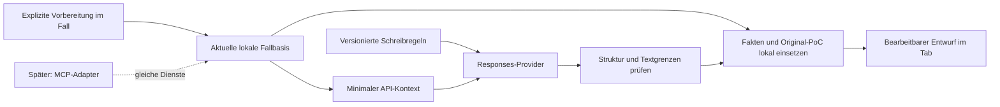

# 2.3.0: E-Mail vorbereiten, Schreibprofile und MCP

Stand: 24. November 2026. Architekturentscheidung zum implementierten ersten 2.3.0-Schnitt und seinem Ausbau. Eine allgemeine lokale Entwurfsverwaltung, importierbare Profilpakete, unabhängiger KI-Review und MCP sind Zukunftsstufen. Eigene lokale Schreibprofile und Beispielmails werden über die KI-Verwaltung gepflegt. Der persönliche Report-Gen-Workflow diente als fachliche Referenz; seine privaten Originalmails, Absenderdaten, lokalen Pfade und historischen Batchanweisungen gehören nicht in dieses Repository.

## Entscheidung: eine kleine Schreibfunktion am bestehenden Fall

„E-Mail vorbereiten“ ist eine explizite Aktion der Falldetailansicht. Die Anwendung prüft die aktuelle Berichtsfreigabe, zeigt die vorgesehenen API-Daten an und erstellt auf Anforderung einen bearbeitbaren Text. Der API-Aufruf verwendet den serverseitigen OpenAI-Schlüssel und das API-Projekt des Betreibers. Er braucht weder eine laufende Codex-Sitzung noch OpenCode, einen MCP-Server oder einen Shellprozess.

Aus dem aktuellen Fall gibt die Anwendung der KI ausschließlich Hostname, gewählte Mailsprache und qualifizierte Komponenten samt Gewissheitsgrad. Die KI formuliert Betreff, Einleitung und Schluss. Die Anwendung setzt die fachlichen Absätze und den vollständigen Original-PoC lokal ein. Empfänger, Signatur, private Notizen, Rohbelege, Request-Header, Cookies und Screenshots werden nicht automatisch aus dem Fall an das Modell übergeben. Ein gewähltes eigenes Schreibprofil ergänzt seine Anweisungen und Beispieltexte; darin selbst eingetragene Informationen sind ebenfalls Teil der ausdrücklich angezeigten API-Vorschau. Private Skilldateien werden nicht automatisch gelesen.

Das Ergebnis bleibt zunächst im geöffneten Tab und kann bearbeitet, kopiert oder als Text heruntergeladen werden. Optional lässt sich der ausdrücklich geprüfte Text inzwischen über eine separate Aktion als Gmail-Entwurf speichern. Dafür existieren dauerhafte Vorgangsbelege in Anwendung und Host-Adapter; eine allgemeine lokale Entwurfsverwaltung ist weiterhin nicht umgesetzt. Fallstatus, Claims, Kontaktmarkierung und Meldeakte bleiben unverändert. Versand, Kontaktrecherche und Zielprüfung gehören nicht zu diesen Aktionen.

Diese Begrenzung ist bewusst: Die vorhandene Anwendung entscheidet über Berichtsfähigkeit und Belege. Sprachgenerierung soll diese Entscheidung verständlich ausdrücken. Ein allgemeiner Agent, der Fälle recherchiert und anschließend eigenständig meldet, wäre ein anderes Produkt.

### Ablauf aus Nutzersicht

1. Im Fall „E-Mail vorbereiten“ öffnen. Der Seitenaufruf liest ausschließlich lokale Daten.
2. Meldeweg, Mailsprache und qualifizierte Aussagen ansehen. UI-Sprache und Mailsprache sind getrennte Einstellungen; eine deutschsprachige Oberfläche bestimmt nicht automatisch die Empfängersprache.
3. Die Vorschau zeigt genau die für OpenAI zusammengestellten Daten und das konfigurierte Modell. „Mit OpenAI entwerfen“ löst den kostenpflichtigen API-Aufruf aus. Ohne Schlüssel sind Vorschau, Download der API-Anfrage und „Ohne KI beginnen“ verfügbar; die KI-Generierung bleibt deaktiviert.
4. Den vollständigen Entwurf im Textfeld prüfen und bearbeiten. Die Kennzeichnung lautet „Ungeprüfter Entwurf“. Betreff, Aussagen, PoC und Empfänger bleiben vor der Verwendung zu prüfen.
5. Kopieren, herunterladen oder nach ausdrücklicher Text-/Empfängerprüfung als Gmail-Entwurf speichern. Ohne Export bleibt der Editor flüchtig; Gmail-Vorgangsbelege sind nach Neuladen sichtbar. Eine tatsächlich erfolgte Meldung trägt der Nutzer weiterhin in der Meldeakte ein.

Ein Formular- oder Portalweg bleibt als solcher sichtbar. Dafür wird Einreichungstext vorbereitet, keine fiktive E-Mail-Adresse. Eine fehlende, abgelaufene oder nicht ausreichend zugeordnete Kontaktquelle darf die Anwendung nicht eigenständig durch eine plausible Adresse ersetzen.

## Vorhandene Integration statt zweiter Falllogik

| Bestehender Baustein | Verantwortung für die Vorbereitung |
|---|---|
| [ReportProjectionService](../../src/Service/ReportProjectionService.php) | Aktuelle, validierte Projektion; Quellidentität, Versionen, Basis, PoC und ausgewählte Komponenten |
| [ReportPolicy](../../src/Cribrum/ReportPolicy.php) | Beleggebundene Komposition und Gate; bleibt unabhängig von KI und Modellwahl |
| [ContactRouteService](../../src/Service/ContactRouteService.php) | Explizit gewählter Kanal, Ziel, Herkunft, Ablaufdatum und Auswahlrevision |
| [FollowUpService](../../src/Service/FollowUpService.php) | Fall- und Domainsperren, geschlossene Nachverfolgung und Revisionsbezug |
| [DisclosureRecordService](../../src/Service/DisclosureRecordService.php) | Bestehende Meldungen und Antworten lesen; eine Textgenerierung legt keinen `reported`-Eintrag an |
| [StudioController](../../src/Controller/StudioController.php) und [Falldetail](../../templates/studio/finding.php) | Einstieg in den bestehenden Ablauf nach Fallprüfung und Kontaktwahl |
| Symfony HttpClient aus [composer.json](../../composer.json) | Direkter HTTPS-Transport; kein zusätzlicher Agent-Runtime-Prozess erforderlich |

Die fachliche Grundlage ist der [Report-Handoff-Vertrag](../cribrum/contracts-v2.md). Ein separater KI-Score, eine Typwahl oder die Einschätzung eines Modells darf dessen Gate nicht ersetzen.

Besonders wichtig sind drei Eigenheiten des bestehenden Vertrags:

- `current()` kann eine historische Projektion zurückgeben, deren Gate auf `hold` gesetzt wurde. Vor der Vorbereitung müssen `isCurrent() === true` und `gate === eligible` gelten. Ein vorhandenes Objekt oder ein früherer Snapshot-Hash reichen nicht.
- `evidence()` enthält neben ausgewählten Fakten auch durch Review ausgeschlossene Fakten. Ein späterer Belegexport muss gezielt `components[].evidenceRefs` auflösen. Die gesamte Rückgabe ist kein Paket ausschließlich berichtsfähiger Aussagen.
- Eine gültige historische XSS-Basis kann `legacy_member` referenzieren. Fehlende Behavior-Fakten allein machen diesen Fall nicht ungültig. Legacy-Auflösung bleibt beim vorhandenen Resolver; es entsteht keine neue pauschale Ausnahme.

Die Handoff-JSON-Schema-Datei nennt für die PoC-Revision derzeit mindestens 1, während Laufzeitmodell und Legacy-Prüfung auch 0 verarbeiten. Der E-Mail-Adapter darf keine zusätzliche Sperre allein aus dieser Abweichung ableiten; eine Vertragsbereinigung ist eine separate Änderung.

### Vier klare Grenzen im Code



**Fallkontext:** [EmailPreparationService](../../src/Service/EmailPreparationService.php) liest die aktuelle Grundlage und erzeugt sowohl den lokalen Vorschautext als auch den externen Minimaldatensatz. Er serialisiert keine Entity und keine vollständige Projektion. Die Datenfelder sind ausdrücklich aufgezählt.

**Schreibregeln:** Ein versionierter, generischer Satz legt die festen Aussagegrenzen und verbotenen Ergänzungen fest. Eigene lokale Profile ergänzen Stilvorgaben und Beispieltexte, ohne diese Grenzen zu ersetzen. Die gewählte Profilrevision und ihr Inhalt gehören zur Anfragebindung. Das eingebaute Profil benötigt keine privaten Beispiele.

**Provider:** [EmailDraftClientInterface](../../src/Service/EmailDraftClientInterface.php) erhält den freigegebenen Kontext und liefert einen Formulierungsvorschlag. Sie kennt keine EntityManager-Schreiboperationen, Kontaktwerkzeuge oder Browserjobs. [OpenAiEmailDraftClient](../../src/Service/OpenAiEmailDraftClient.php) ist die erste Implementierung; Tests verwenden einen Fake.

**Zusammensetzung und Darstellung:** Der Server prüft das Ergebnis, ergänzt seine eigenen fachlichen Blöcke und den unveränderten PoC und rendert Klartext. [EmailPreparationController](../../src/Controller/EmailPreparationController.php) koordiniert GET-Vorbereitung und CSRF-geschützte POST-Vorschau/Generierung; [prepare-email.php](../../templates/studio/prepare-email.php) zeigt den Editor. Mehrstufige Agent-Orchestrierung ist dafür nicht notwendig.

## Datenvertrag und fachliche Aussagen

Beispiel des externen Kontexts mit ausschließlich synthetischen Daten:

```json
{
  "website_host": "shop.example.invalid",
  "language": "de",
  "selected_findings": [
    {"label": "Cross-Site Scripting", "certainty": "confirmed"},
    {"label": "SQL injection", "certainty": "suspected"}
  ]
}
```

Die Feldmenge des Fallkontexts ist geschlossen. Der Host wird serverseitig aus dem Original-PoC des konkreten Falls bestimmt. Der Browser kann weder fremde Fallinhalte noch Empfänger oder Rohbelege als aktuelle Fallfakten unterschieben. Eigene Stilanweisungen und Beispiele stammen ausschließlich aus dem gewählten gespeicherten Profil; sie bleiben von den aktuellen Fallfakten getrennt. Die Vorschau zeigt die vollständige API-Anfrage einschließlich Profilinhalt, festen Schreibregeln und Ausgabeschema.

| Komponente | Lokal festgelegte Aussagegrenze |
|---|---|
| `xss_confirmed` | Bestätigte XSS; keine Abschwächung zu bloßer Möglichkeit, keine erfundenen Folgen wie Kontoübernahme |
| `sqli_suspected` | Begründeter Verdacht; keine behauptete erfolgreiche SQL-Injection oder Datenextraktion |
| `sql_error_observation` | Beobachteter SQL-Fehler; daraus allein folgt keine SQLi |
| `information_disclosure` | Belegte Offenlegung interner Informationen; keine erfundene konkrete Datei, Query oder Konfiguration |
| `lfi_suspected`, `rfi_suspected` | Begründeter Include-Verdacht; keine behauptete Dateilesung oder Codeausführung |

Alle ausgewählten qualifizierten Komponenten stehen gemeinsam in einem Entwurf. Die Anwendung darf keine XSS-only-Mail erzeugen, wenn die aktuelle Komposition zusätzliche qualifizierte SQL-Komponenten verlangt. `caseSummary.hints`, unqualifizierte Claims und Tags erzeugen keine weiteren Empfängerabsätze. Unvollständige Triageabdeckung erzeugt ihrerseits keine zusätzliche Mail-Sperre für eine anderweitig gültige Freigabe.

Der erste Schnitt überträgt keine konkreten Belegausschnitte. Deshalb kann er keine fallspezifischen Ursachen oder Detailanalysen von der KI erwarten. Lokal formulierte Behebungshinweise bleiben allgemeine Empfehlungen; sie dürfen beispielsweise eine bestimmte fehlerhafte Codezeile oder verwendete Datenbank nicht behaupten. Für eine vollständige technische Meldung können später kontrollierte, beleggebundene Detailbausteine ergänzt werden.

Der vollständige `poc.effectiveUrl` wird erst nach der Modellantwort aus der lokalen Grundlage eingesetzt. Kein Modell muss ihn nachschreiben, entschärfen, dekodieren oder rekonstruieren. Prozentkodierung, Parameterreihenfolge, Unicode und Originalschreibweise bleiben erhalten. Darstellung über escaped Textfelder beziehungsweise `text/plain`; keine Interpretation als HTML. Ein Leak-Check untersucht generierte Prosa getrennt vom Original-PoC, damit Wörter innerhalb der URL weder zu einer Umschreibung noch zu einem falschen Leak-Befund führen.

## Direkte OpenAI-Anbindung

Der Server verwendet `POST https://api.openai.com/v1/responses` mit einem Schlüssel aus der Serverumgebung. cURL eignet sich für einen separat ausgeführten synthetischen Verbindungstest; das Produkt verwendet den bereits vorhandenen HTTP-Client. Authentifizierung und Anfrageform sind im [Responses-API-Vertrag](https://developers.openai.com/api/reference/resources/responses/methods/create) beschrieben.

Produktvorgabe ist `gpt-6.2-sol` mit `reasoning.effort: medium`; `gpt-6.2-astra` ist eine bewusst wählbare Alternative. Exakte Modell- und Effort-Werte werden validiert und angezeigt. Eine ausdrückliche Auswahl wird bei Fehlern nicht automatisch ersetzt. Die Anwendung akzeptiert `low`, `medium`, `high`, `xhigh` und `max`; Unterstützung und tatsächlicher Zugriff müssen zum Modell und API-Projekt passen. Die Variante `ultra` einer Coding-Runtime ist kein dokumentierter Responses-Parameter. [Offizieller Modellkatalog](https://developers.openai.com/api/docs/models), [GPT-6.2 Sol](https://developers.openai.com/api/docs/models/gpt-6.2-sol).

Stabile Schreibregeln stehen als erste `developer`-Nachricht in `input`, Falldaten als separate `user`-Nachricht. Bei GPT-6.2 ist diese Anordnung für wiederverwendbare Regeln ausdrücklich dokumentiert. Für diese Integration werden keine Sampling-Parameter wie `temperature` benötigt. [GPT-6.2-Leitfaden](https://developers.openai.com/api/docs/guides/latest-model).

Die Antwort verwendet `text.format` mit `type: json_schema`, `strict: true`, erforderlichen Feldern und `additionalProperties: false`. Vorgesehene Felder sind `subject`, `opening` und `closing`, jeweils begrenzter Klartext. Der Adapter prüft zusätzlich HTTP-Status, `status === completed`, Ablehnungen, unvollständige Ergebnisse, genau die erwarteten Textbestandteile und Größenlimits. Ein formal gültiges JSON ist kein Beleg für sachlich richtige Prosa. [Structured Outputs](https://developers.openai.com/api/docs/guides/structured-outputs).

Für den ersten Schnitt gelten außerdem:

- Festes API-Ziel, TLS-Prüfung, keine Redirects mit Authorization-Header, keine vom Browser konfigurierbare Basis-URL.
- Keine Tools, Websuche, MCP-Verbindung, Dateiuploads, gespeicherte Konversation oder `previous_response_id`.
- `store: false` explizit setzen. Das ist keine Zusage vollständiger Nichtaufbewahrung; die dokumentierten Plattform- und Kontoeinstellungen gelten weiterhin. [OpenAI-Datenkontrollen](https://developers.openai.com/api/docs/guides/your-data).
- Begrenzte Request-/Response-Größe, Ausgabe-Tokenzahl und Laufzeit. API-Fehler werden knapp klassifiziert; weder Schlüssel noch vollständige Providerfehler oder Falldaten gehören in Logs.
- Keine automatische Wiederholung bei Timeout, 429 oder unklarem Ausgang. Die Anfrage kann bereits verarbeitet worden sein. Ein erneuter bewusster Klick kann erneut Kosten verursachen.
- Ohne Schlüssel erfolgt kein externer Aufruf. Schlüssel gehören weder in Browserzustand und URLs noch in Prompts, Fehlermeldungen, Beispielkommandos mit echten Werten oder Git.

## Aktualität über die API-Wartezeit hinweg

Vor der Anfrage entsteht ein Fingerprint der lokal gelesenen Grundlage. Nach der Antwort wird die Grundlage erneut gelesen und verglichen. Eine SQLite-Transaktion bleibt nicht während des API-Aufrufs offen.

Der Fingerprint bindet mindestens Quellinstanz, Schema-/Policy-Version, Basis- und Entscheidungsrevision, ausgewählte Komponenten, PoC-Revision und exakte PoC-Bytes, aktuelle Claim-/Quellbindung, Kontaktwahlrevision, relevante Fall-/Domainsperren, frühere Meldungsmarker, Mailsprache und Schreibregelversion. Der Browser übergibt ausschließlich den erwarteten Fingerprint; der Server berechnet alle Inhalte erneut. Vertrauenswürdige Snapshot-Hashes stammen aus validierten gespeicherten Bytes, nicht aus einer beliebigen JSON-Neuserialisierung.

Die Prüfung umfasst zusätzliche aktuelle Workflowgrenzen: verworfen, behoben, geschlossen, Kontakt untersagt oder schon als Erstmeldung kontaktiert/gemeldet. Dafür müssen sowohl bestehende Fallmarker als auch passende Meldeakteneinträge berücksichtigt werden. Ein `checks_blocked` allein ist von `contact_blocked` zu unterscheiden: Textvorbereitung führt keine Zielprüfung durch.

Ändert sich die Grundlage während des Aufrufs, wird das Ergebnis nicht als aktueller verwendbarer Entwurf ausgegeben. Die Anwendung erklärt, dass der Fall erneut geladen werden muss. Eine abgelaufene Kontaktquelle wird erneut anhand der Uhrzeit geprüft; bloß unveränderte Zeilenwerte reichen nicht. Allein eine unveränderte PoC-URL deckt zudem keine Änderung von Request-Body, Marker oder Payload ab; diese gehören zur vorhandenen Berichtsbasis.

Die zustandslose Modellgenerierung hat Grenzen: Nach dem Anzeigen kann sich die Fallbasis erneut ändern; eine bereits kopierte Datei kann nicht zurückgerufen werden. Es gibt keine allgemeine dauerhafte Entwurfsfreigabe und keinen Nachweis, dass ein später außerhalb der Anwendung bearbeiteter Text noch der geprüften Grundlage entspricht. Ohne Modell-Auftragsbuch lässt sich auch keine garantierte einmalige API-Abrechnung für doppelte Generierungs-POSTs versprechen. Die UI verhindert versehentliche Mehrfachklicks, bezeichnet das aber nicht als transaktionale Deduplizierung. Der separate Gmail-Schreibvorgang besitzt dagegen dauerhafte Vorgangsbelege, eine erneute Aktualitätsprüfung und eine Bindung an den konkret geprüften Text.

### Textgrenzen und ehrliche Qualitätsaussage

Auch ein Modell mit nur drei Ausgabefeldern könnte in einer Einleitung zusätzliche Funde, Tests, Fristen, Identitäten oder Folgen erfinden. Feste technische Absätze verringern dieses Risiko, beseitigen es aber nicht.

Die Regeln verlangen eine neutrale Anrede, keine neuen Tatsachen in Einleitung/Schluss, keine erfundenen Qualifikationen, keine Zahlungsforderungen und keine angeblich erfolgten Tests. Links, Empfängerfelder, zusätzliche PoCs und interne Tool-/Fallreferenzen sind dort nicht zulässig. Betreff und Einleitung dürfen keinen unbelegten Dringlichkeitsanspruch enthalten; der erste Schnitt kann durchgehend sachliche Betreffzeilen verwenden. `urgencyAllowed` ist nur eine fachliche Erlaubnis, keine Pflicht.

Längen-, Struktur-, Link- und Wortprüfungen sind deterministische Schutzmaßnahmen, keine vollständige semantische Prüfung. Das Produkt bleibt deshalb bei „Entwurf prüfen“. Es behauptet weder ein unabhängiges Review noch eine tatsächliche Sicherheitsprüfung durch die KI. Neue Eingaben und Modellantworten werden ausschließlich escaped dargestellt.

## Aus einem persönlichen Skill wird ein wiederverwendbares Schreibprofil

Der vorhandene Report-Gen-Skill verbindet mehrere Aufgaben: Kontaktrecherche, Fallauswahl, Belegeinordnung, persönliche Stilregeln, unabhängiges Review, Queuekoordination und Gmail-Ablage. Diese Gesamtanweisung unverändert als Systemprompt einzulesen würde persönliche Daten und nicht beauftragte Aktionen in das Produkt bringen.

Die übertragbaren Regeln bilden stattdessen ein kleines, versioniertes Profil: klarer Ton, Bestätigung und Verdacht trennen, keine erfundenen Auswirkungen, richtige Mailsprache, unveränderte PoCs und Trennung von internen Prüfnotizen und Empfängertext. Öffentliche Beispiele verwenden ausschließlich synthetische Organisationen und `.invalid`-Domains.

Die lokale KI-Verwaltung unter `/settings/ai` speichert benannte Profile, eigene Stilanweisungen und begrenzte Beispielmails. Änderungen erzeugen Revisionen; Archivierung entfernt die Auswahl für neue Vorbereitungen und bewahrt die Historie. Ein Standardprofil gilt für neue Editoren, nicht rückwirkend für vorhandene Entwürfe. Profilidentität, Revision und Inhalt verändern den Kontextfingerprint und bleiben auch bei Gmail-Vorgängen gebunden. Ein Profil ist Inhalt, kein ausführbares Plugin: keine Shellbefehle, Includes, rekursiven Dateizugriffe oder Netzfreigaben.

Die Profilverwaltung schreibt in die private Anwendungsdatenbank; Speichern allein macht keinen Modellaufruf. Erst die gewählte Profilfassung und die ausdrückliche Generierung übermitteln deren angezeigte Inhalte. Beispiele werden nicht automatisch anonymisiert: Selbst eingetragene Namen, Adressen und URLs sind entsprechend sichtbar zu prüfen. Profilhistorie und Beispiele gehören zu den privaten Datenbanksicherungen. Absendersignaturen bleiben lokale Editorwerte. Historische Modellwahlen, Batchquoten und Gmail-Anweisungen werden nicht aus persönlichen Dateien geerbt.

## MCP als späterer Adapter

Skill, Provider und MCP erfüllen verschiedene Aufgaben: Das Profil erklärt, wie geschrieben wird. Der Provider erzeugt Text. MCP stellt abgegrenzte Daten und Aktionen für einen externen Client bereit. Diese Trennung lässt denselben Fallkontext sowohl in der Oberfläche als auch später in einem Coding-Client nutzen.

Ein erster MCP-Ausbau sollte ausschließlich lesende Werkzeuge anbieten:

| Vorgeschlagenes Tool | Ergebnis und Grenze |
|---|---|
| `list_preparable_cases` | Begrenzte, paginierte Liste mit aktueller Eignung; keine ganzen Fallakten |
| `get_case_summary` | Falltyp, aktuelle Komponenten, Gründe und Revisionen; interne Informationen ausdrücklich getrennt |
| `get_email_context` | Derselbe minimale Kontext wie in der UI, gebunden an Fall und erwartete Revision |
| `get_contact_route` | Gewählte Route und Herkunft; keine automatische Recherche oder Auswahländerung |
| `list_writing_profiles` | Installierte IDs, Versionen und Fähigkeiten; keine privaten Originaldateien |
| `get_email_draft` | Erst nach Einführung lokaler Persistenz; standardmäßig Zusammenfassung, opake Referenz, Revision und Aktualitätsstatus |

Die Werkzeuge brauchen authentifizierte, fallbezogene Leseberechtigungen und feste Ergebnislimits. Keine freie SQL-Abfrage, kein beliebiger Dateipfad, keine Shell, keine generische URL-Fetch-Funktion und keine Schlüssel im Tool-Ergebnis. Der externe Client entscheidet über seine eigene Modellübermittlung; eine Leseberechtigung ist keine allgemeine Schreib- oder Versandberechtigung. Vollständige Entwurfstexte benötigen eine eigene Inhaltsfreigabe: Auch ein rein lesender Abruf kann den lokal eingesetzten PoC an das Modell des Clients weiterreichen.

Spätere Schreibwerkzeuge können `prepare_email_draft` und `save_email_draft_revision` heißen. Sie verwenden denselben Dienst, erwartete Quell-/Entwurfsrevisionen und einen idempotenten Auftragsbezug. Menschliche Reviewbestätigung darf nicht aus einer Tool-Antwort oder einem Modell-PASS erfunden werden. Der inzwischen vorhandene Gmail-Connector ist ein separater Host-Writer mit bestehendem OAuth, lokaler Socket-Schnittstelle, globaler Schreibsperre, dauerhaften Vorgangsbelegen und exakter Rückprüfung. Die [Betriebsanleitung](../AI_EMAIL.md) beschreibt seinen Umfang. Ein Send-Tool ist nicht vorgesehen.

OpenAIs Remote-MCP-Anbindung unterstützt über das Netz erreichbare Server mit Streamable HTTP oder HTTP/SSE. Sie ist keine direkte Verbindung zu einem lokalen stdio-Prozess. Die offizielle Dokumentation beschreibt außerdem Secure MCP Tunnel über `tunnel_id` für lokale/private Server ohne öffentliche Freigabe; diese Option kann später geprüft werden, ist hier aber weder eingerichtet noch hinsichtlich Kontoverfügbarkeit bestätigt. Für den ersten lokalen Ausbau sind ein lokaler MCP-Adapter für einen lokalen Client oder eine vom Anwendungsbackend kontrollierte Tool-Schleife sinnvoll. Toolfreigaben und erlaubte Werkzeuglisten bleiben explizit. [Offizielle MCP-Dokumentation](https://developers.openai.com/api/docs/guides/tools-connectors-mcp).

## Ausbaureihenfolge und Abnahme

| Stufe | Lieferumfang | Voraussetzung |
|---|---|---|
| Erster 2.3.0-Schnitt | Lokale Vorschau, minimaler Responses-Aufruf, deterministische Fakten/PoC, bearbeitbarer Text, Kopie/Download | Aktuelle Projektion, explizite Aktion, API-Konfiguration für KI-Formulierung |
| Dauerhafte Entwürfe | Eigene Entwurfs- und Revisionsspeicherung, Quelle/Fingerprint, menschliche Änderungen, veraltete Fassungen, explizites Review | Keine Vermischung mit `disclosure_activity`; alte Texte bleiben nachvollziehbar |
| Lokale Schreibprofile (umgesetzt) | Eigene Anweisungen und Beispielmails, Revisionen, Standardwahl und Archivierung | Auswahl im Editor, vollständige Payloadvorschau, Profilbindung bis zum Gmail-Vorgang |
| Profilpakete (geplant) | Importierbare generische/private Profile, zusätzliche Mailarten, kontrollierte Details | Validiertes Importformat, Herkunft und sichere Profilinstallation |
| MCP lesen | Schmale Adapter auf dieselben Dienste | Authentifizierung, Scopes, Datenlimits und identische Aktualitätsprüfung |
| Gmail-Connector (umgesetzt) | Explizite Anlage des geprüften Texts; lokale Vorgangsbelege, Rückprüfung und Wiederaufnahme bekannter IDs | Bestehende Host-Anmeldung, gleiche Unix-Identität, separate Freigabe im Editor |
| MCP schreiben (geplant) | Revisionsgebundene Draft-Aktionen auf denselben Diensten | Eigenständige Toolberechtigung, Inhaltsfreigabe und expliziter menschlicher Review |

Ein Hintergrundjob wird erst mit dauerhaften Aufträgen sinnvoll: `queued`, `running`, `succeeded`, `failed`, `unknown` und `stale` müssen getrennte Zustände sein. Transportabschluss, fachliche Aktualität und redaktionelles Review sind unterschiedliche Dimensionen. Timeout bedeutet nicht sicher „nicht ausgeführt“. Dafür bestehende Browserqueues nicht zweckentfremden.

Die gezielte Abnahme des ersten Schnitts verwendet synthetische Fixtures und einen Fake-Provider:

- Kein API-Aufruf bei GET, ungültigem CSRF, fehlendem Schlüssel, falschem Fingerprint, altem Gate, gesperrtem Kontakt oder unsupported Komponenten.
- Exakter Minimalrequest mit eingebautem Profil: keine PoC-URL, Empfängeradresse, Signatur, Notizen, Belege, Header oder Dateipfade. Hostname, Sprache und Komponenten entsprechen der Vorschau. Eigene Profile ergänzen ausschließlich die sichtbar gewählten Anweisungen und Beispiele, getrennt von aktuellen Fallfakten.
- XSS, SQLi-Verdacht, SQL-Fehler, Disclosure und Include-Verdacht behalten ihre jeweiligen Aussagegrenzen; Mischfälle bleiben vollständig.
- PoC mit Prozentkodierung, Unicode, `+`, mehreren Parametern und einem internen Schlüsselwort bleibt bytegleich; HTML wird nicht ausgeführt.
- Eine zwischen Vorschau, API-Aufruf und Antwort geänderte Fallbasis beziehungsweise Kontaktwahl verwirft das Resultat. Ablauf während des Aufrufs ist ebenfalls abgedeckt.
- Ablehnung, falsche JSON-Struktur, unbekannte Felder, unvollständige Antwort, zu große Ausgabe, Timeout und Providerfehler erzeugen keinen scheinbar erfolgreichen Entwurf und keine automatischen Folgeaufrufe.
- Keine Änderungen an Finding, Claims, Kontaktwahl, Nachverfolgung oder Meldeakte; keine Browserjobs und keine Zielrequests.
- DE/EN, Tastaturbedienung, Kopie/Download und Hinweis auf fehlende Persistenz funktionieren. Persönliche Originalmails und reale Falldaten werden nicht als Testmaterial verwendet.

Ein optionaler Live-Verbindungstest verwendet ausschließlich synthetische Inhalte und prüft tatsächliche Modellverfügbarkeit im konfigurierten API-Projekt. Eine erfolgreiche Coding-Client-Sitzung beweist weder API-Key-Verfügbarkeit noch Kosten-, Zugriffs- oder Retentionseinstellungen dieser Anwendung.
